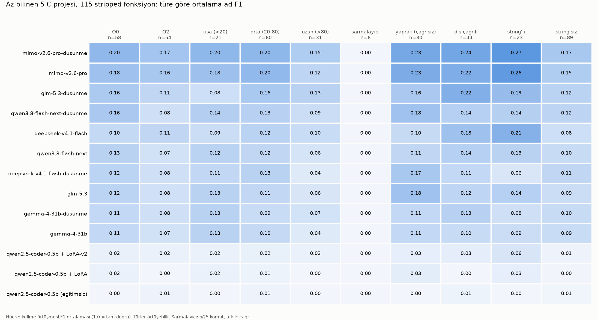

# asmsense

**English** · [Türkçe](README.tr.md)

**A small language model that looks at a function in a stripped binary and gives it a meaningful name and a short description.**

## Current status

The v4 dataset contains 228,177 functions from 341 projects across 5 optimization levels and is published on [Hugging Face](https://huggingface.co/datasets/krxi123/asmsense) under the `v4` config. Qwen3-8B + LoRA v6 adds anonymized Ghidra pseudocode to assembly and call context: name F1 is 0.135 on the fixed 2,000-row test sample versus 0.124 for v5, but 0.135 on `eval_115` versus 0.155 for v5. The improvement does not carry across both checks; both planned F1 targets (0.14 / 0.17) were missed. The source-aware English explanation audit is 62/294 correct (21.1%), with six judge failures; the 25% target was also missed. The model generates English/Turkish descriptions and a name; these suggestions still need review. See Results, sections 6–7. The [v6 Apache-2.0 adapter and full-precision evidence](https://huggingface.co/krxi123/asmsense-lora-v6) are public; the [historical v5 adapter](https://huggingface.co/krxi123/asmsense-qwen3-8b-lora) remains available separately.

Open a stripped program in Ghidra or IDA and you will see hundreds of functions named `FUN_00401a30`. Much of reverse engineering consists of understanding and naming these functions one by one. This project aims to teach a model that first step:

```
input  (stripped x86-64)             target output
─────────────────────────────         ──────────────────────────────────────────────
movzx  eax, byte ptr [rsi]            name:        adler32_update
lea    rdx, [rdi + rax]               description: Computes the Adler-32 checksum
cmp    rdx, 0xfff1      ← 65521                    over the bytes of a buffer.
...                                   # TR: Tampondaki baytlar üzerinden Adler-32
                                      #     sağlama toplamı hesaplar.
```

## Goal

Large general-purpose models can handle this task to some extent, but they are slow, expensive, and cloud-hosted. The goal is to answer this question:

> Can a **small** model trained on purpose-built data match or even outperform large models on this task—while running on a laptop?

Three tiers are evaluated on the same test set:

| Tier | Model | Role |
|---|---|---|
| Ceiling | Large open models (DeepSeek, GLM, MiMo, Gemma, Qwen) | The best currently achievable with off-the-shelf models |
| Baseline | Small open model, before fine-tuning | Starting point |
| **This project** | The same small model + LoRA on this dataset | The project's contribution |

## How it works

1. **Data generation (`cikar.py`):** Open-source C projects are compiled for x86-64 at different optimization levels (`-O0`, `-O2`). The assembly for each function is extracted. The ground truth—the original function name—comes directly from the source, so no manual labeling is needed. `projeler.json` records the commit and compiler flags used for every project.
2. **Simulating a stripped binary:** The output resembles what Ghidra shows for a function in a stripped binary:
   - project-local functions become `sub_01a3`, and global data becomes `dat_0042` (the numbers are shuffled, with separate namespaces for `-O0` and `-O2`),
   - branch targets use function-local labels such as `loc_1` and `loc_2`,
   - external library calls (`memcpy`, `__stack_chk_fail`) and string literals (`; -> "out of memory"`) remain visible because they are also visible in a real binary.
   
   If the function's real name appears in its own assembly—for example, in an error message—the row is marked `sizinti` and excluded from the test set.
3. **Initial assembly-only baseline (`taban.py`):** The model receives assembly and predicts a name. Later evaluations add call context; v6 additionally uses prepared, anonymized Ghidra pseudocode with the original assembly/context. Predictions are scored by token overlap (F1), so close answers such as `crc32_update` and `update_crc` receive partial credit.

```
loc_6:
movzx   r9d, byte ptr [rsi + rdx]
add     rdi, r9                 ← adler32_z (-O2), as the model sees it
add     rcx, rdi
inc     rdx
cmp     rax, rdx
jne     loc_6
```

## Data

| | Projects | Functions (-O0 + -O2) |
|---|---|---|
| Training | zlib, libpng, sqlite, lua, mbedtls, zstd, libsodium, expat, brotli, jansson, lz4, libyaml, xxhash, cJSON | 16,804 |
| Test (memorization-resistant) | tomlc17, cyaml, mu_json_x, sajs, picomatch | 777 → evaluation set: 115 compiled rows, 95 unique source functions |

The dataset is available on Hugging Face: [krxi123/asmsense](https://huggingface.co/datasets/krxi123/asmsense) (16,804 training examples, 777 test examples, the `eval_115` evaluation set, and license texts). It is also mirrored on Kaggle: [krxiii/asmsense](https://www.kaggle.com/datasets/krxiii/asmsense).

### Scaled dataset (v4 pipeline, 5 optimization levels)

Permissively licensed (MIT, BSD, Apache-2.0, ISC, zlib) C projects selected from GitHub with `olcekle.py` were compiled at `-O0/-O1/-O2/-O3/-Os` using `cikar_bin.py` (real dylib + `strip -x`). Project build scripts were not run; files were compiled individually with clang, and files or projects that failed to compile were skipped. Rows were deduplicated by normalized assembly hash. Rows with assembly identical to validation/test data were removed from training; validation/test rows with matching (file, name) pairs in training were also removed. This does not remove every renamed or relocated vendored copy. Every row has a `lisans` field.

| Split | Projects | Rows | Unique source functions |
|---|---:|---:|---:|
| Training | 290 | 196,117 | 72,179 |
| Validation | 23 | 19,770 | 6,667 |
| Test (little-known, ≤200 stars, 2024+) | 28 | 12,290 | 4,685 |

Of 473 projects, 352 produced rows and 120 failed to compile (kernel, embedded, or platform-dependent code). Only clang was used. The data is kept outside Git and can be regenerated with `python3 aday_bul.py` and `python3 olcekle.py hepsi`.

The training/test split uses disjoint **root-project identifiers**: rows from one root project do not appear on both sides, but vendored source families can cross that boundary. Test projects were deliberately chosen to be little-known (2-190 stars), and most were started in 2024-2025; this reduces obvious pretraining-overlap risk compared with zlib but does not prove its absence. Licenses: [veri/LISANSLAR.md](veri/LISANSLAR.md).

**Known exception: vendored code.** An independent audit of the released v6 data ([rapor/arastirma/V6_VERI_DENETIMI.md](rapor/arastirma/V6_VERI_DENETIMI.md), `veri_denetim_v6.py`) confirmed no shared root-project identifier, id or (project, file, name) key, but test project `snkv` embeds SQLite under its own file names while `sqlite` is a training project. The fixed 2,000-row test sample has 217 rows (10.85%) with names identical to SQLite training functions; `valid_300` has 16 such rows (5.3%). These are name-overlap candidates, not verified identical-source counts. Historical score slices (section 6) do not establish that overlap has no effect on results; the detailed content census and its limitations are reported separately below.

## Results

### 1. Memorization-resistant test: 5 little-known projects, 115 functions

Mean name F1 (1.0 = exact match). In the “Prefix-stripped F1” column, each project's common name prefix (`cyaml_`, `mu_`, `sajs_`) is removed from both sides; the model cannot infer this prefix from assembly.

| Model | -O0 | -O2 | Prefix-stripped F1 | Exact matches |
|---|---|---|---|---|
| mimo-v2.6-pro (reasoning) | **0.20** | **0.17** | **0.21** | 3 / 115 |
| mimo-v2.6-pro | 0.18 | 0.16 | 0.20 | **4 / 115** |
| glm-5.3 (reasoning) | 0.16 | 0.11 | 0.15 | **4 / 115** |
| qwen3.8-flash-next (reasoning) | 0.16 | 0.08 | 0.13 | 3 / 115 |
| deepseek-v4.1-flash (reasoning) | 0.12 | 0.08 | 0.12 | 3 / 115 |
| deepseek-v4.1-flash | 0.10 | 0.11 | 0.12 | 2 / 115 |
| glm-5.3 | 0.12 | 0.08 | 0.12 | 2 / 115 |
| qwen3.8-flash-next | 0.13 | 0.07 | 0.11 | 1 / 115 |
| gemma-4-31b (reasoning) | 0.11 | 0.08 | 0.10 | 2 / 115 |
| gemma-4-31b | 0.11 | 0.07 | 0.10 | 0 / 115 |
| qwen2.5-coder-0.5b, untrained | 0.00 | 0.01 | 0.01 | 0 / 112 |
| qwen2.5-coder-0.5b + LoRA v1 | 0.02 | 0.00 | 0.01 | 0 / 112 |

Reasoning runs used a `max_tokens` ceiling of 12,288. Even at that limit, deepseek and qwen failed to finish reasoning and produce an answer on more than half the requests; glm did the same on 50 of 115. These rows were scored as 0.

### 2. Memorization: reasoning helps on famous code, not unfamiliar code

Same data pipeline, same number of functions (115), mimo-v2.6-pro:

| | Without reasoning | With reasoning |
|---|---|---|
| zlib (very well known) | 9 exact matches, F1 0.18 | **28 exact matches**, F1 0.29 |
| little-known projects | 4 exact matches, F1 0.20 | 3 exact matches, F1 0.21 |

Reasoning triples the number of exact matches on zlib and contributes nothing on little-known code. The most likely explanation is that, during reasoning, the model is not “understanding” the assembly but recalling source code it has seen before. Evaluating off-the-shelf models on famous libraries therefore gives a misleading picture of performance on this task.

### 3. Where models fail



- **Wrappers: 0 for every model.** The name of a short function that merely calls one internal function cannot be recovered without knowing the callee (call context did not help either; see 4).
- **Strings are the strongest signal.** F1 is markedly higher for functions containing string literals (0.27 versus 0.15 for mimo).
- **-O2 is harder.** Nearly every model scores lower at -O2 than at -O0.
- **Long functions are not inherently easy.** On zlib, long functions are the easiest group (mimo with reasoning: 0.58; [chart](grafik/zlib-hata.png)); on little-known code, the same group scores 0.15—another trace of memorization.

### 4. Call context

Information about internal callees was added to each function's assembly (without reasoning, prefix-stripped F1):

- **summary**: callees' imports, internal calls, and strings
- **deep**: also includes the full assembly of short callees and a two-level summary

| Model | No context | Summary | Deep | Long functions (no context → deep) |
|---|---|---|---|---|
| mimo-v2.6-pro | 0.20 | 0.22 | **0.24** | 0.12 → 0.25 |
| deepseek-v4.1-flash | 0.12 | 0.17 | 0.17 | 0.10 → 0.18 |
| qwen3.8-flash-next | 0.11 | 0.15 | 0.16 | 0.06 → 0.18 |
| gemma-4-31b | 0.10 | 0.09 | 0.10 | 0.04 → 0.11 |
| glm-5.3 | 0.12 | 0.14 | 0.13 | 0.06 → 0.05 |

Context helps most for long functions and functions that call other internal functions (except for glm: responses were truncated on 35 of 115 requests, indicating that long inputs hurt it). Deep context adds little over the summary. **Wrappers remain at 0 even with deep context** (there are only 6 in the test set; even the callee's complete assembly does not lead the model to the correct name).

### 5. Small model, first LoRA attempt (MacBook Air M4)

Qwen2.5-Coder-0.5B (4-bit), 1,500 steps (~1 hour 40 minutes, 4,8 GB memory). Neither attempt **worked**:

| Run | Data | F1 | Exact matches | What happened |
|---|---|---|---|---|
| Untrained | — | 0.01 | 0 / 112 | most responses were meaningless |
| LoRA v1 | 14,710 functions, original names | 0.01 | 0 / 112 | memorized project prefixes: 54 of 112 predictions were `mbedtls_…` |
| LoRA v2 | 10,360 functions, prefixes removed, ≤1,500 per project | 0.02 | 0 / 112 | mode collapse: 56 of 112 predictions were one of two names |

The 0.5B model and half an epoch appeared insufficient for this task. Subsequent larger-model, call-context and pseudocode experiments are reported in sections 6–7.

### 6. Larger small models: 1.5B and 8B LoRA

Same fixed v4 test sample (`lora/test_sabit_idler.txt`, little-known test projects) and the `eval_115` set. Name F1 compares with the real name; prefix-stripped F1 removes the project prefix from both sides. F1 is the mean per-function name-token F1, not a description-quality score or the percentage of correct names. Details: [rapor/MOLAB_IKI_F1.md](rapor/MOLAB_IKI_F1.md), [sonuc/SABIT500_LORA15_V3.md](sonuc/SABIT500_LORA15_V3.md).

| Model | Test set | n | Name F1 (-O0 / -O2 / all) | Prefix-stripped F1 (all) | F1=1 matches (name / prefix-stripped) |
|---|---|---:|---|---:|---|
| mimo-v2.6-pro, with call context (large, reference) | v4 test, fixed sample | 2,000 | 0.178 / 0.154 / 0.167 | 0.170 | 40 / 45 |
| deepseek-v4.1-flash, with call context (large, reference) | v4 test, fixed sample | 2,000 | 0.161 / 0.130 / 0.154 | 0.156 | 40 / 45 |
| **Qwen3-8B + LoRA v6** (assembly + context + Ghidra pseudocode) | v4 test, fixed sample | 2000 | 0.140 / 0.112 / **0.135** | 0.137 | 31 / 37 |
| **Qwen3-8B + LoRA v6** | `eval_115` | 115 | 0.175 / 0.092 / **0.135** | 0.153 | 2 / 3 |
| Qwen3-8B + LoRA v5 (description → name, 95k rows, 1 epoch) | v4 test, fixed sample | 2,000 | 0.127 / 0.098 / 0.124 | 0.126 | 26 / 31 |
| Qwen3-8B + LoRA v5 | `eval_115` | 115 | 0.188 / 0.120 / 0.155 | 0.173 | 1 / 2 |
| Qwen3-8B + LoRA v1 (name only, 41k rows × 2 epochs) | v4 test, fixed sample | 2,000 | 0.108 / 0.093 / 0.106 | 0.108 | 25 / 33 |
| Qwen3-8B + LoRA v1 | `eval_115` | 115 | 0.102 / 0.085 / 0.094 | 0.111 | 1 / 4 |
| Qwen2.5-Coder-1.5B + LoRA v3, with call context (MLX, laptop) | first 500 of the fixed sample | 500 | 0.044 | 0.045 | 0 |
| Qwen2.5-Coder-1.5B + LoRA v3, assembly only | first 500 of the fixed sample | 500 | 0.037 | 0.038 | 0 |

The historical table's “exact matches” counts use name-token F1=1, which can include differently ordered/cased identifiers with the same token set; this is not necessarily byte-for-byte name equality. The v6 literal string-exact counts are 21 on the fixed test and 1 on `eval_115`, reported separately from F1=1 matches.

**Outside the vendored project (historical v5 comparison, not a v6 result).** Without `snkv` (1,491 of the 2,000 rows), name F1 is 0.132 for v5 and 0.190 for mimo-v2.6-pro with call context; the paired v5 − mimo gap widens from −0.044 [−0.076, −0.021] to −0.058 [−0.082, −0.033] (project-cluster bootstrap, 2,000 draws). The headline figures keep all 2,000 rows so they remain comparable with earlier runs.

On the same 500 rows the 8B v1 model scores 0.108 versus 0.044 for 1.5B. The 1.5B adapter does not generalize to new projects and shows strong mode collapse (the most frequent prediction covers 13.6% of rows). The 8B model was the first small model clearly above zero.

**v5 versus v1 (historical comparison, same base model and 2,000 test rows).** v5 changed the data and the target: every source function appeared at least once (95,000 rows, 72,061 functions), the project-prefix rule was fixed, and the model first wrote a one-sentence English description, then the name, then a Turkish description. Name F1 rose from 0.106 to 0.124 (paired difference +0.018, 95% bootstrap interval +0.009 to +0.026) and from 0.094 to 0.155 on `eval_115`. Predictions that were verbatim copies of a training name dropped from 42% to 30%. Functions without string constants remained the hard case (0.093, up from 0.079; with strings 0.299). The v5 checkpoint was selected on 300 validation rows (step 4,500 of 5,938; validation name F1 0.263).

**v6 versus v5.** v6 keeps the same 95,000 training row IDs and targets, but adds anonymized Ghidra pseudocode to the assembly and call context. The selected v6 checkpoint is step 4500 of 5938; selection protocol: maximum valid_300 name-token F1 across 12 scheduled checkpoints; selected step 4,500 (0.2680531506); ties retain the earlier checkpoint. Test results were generated only after training ended, not used for checkpoint selection. On ID-aligned predictions, the mean name-F1 difference (v6 − v5) is +0.011 on 2000 fixed-test rows (95% interval +0.002 to +0.018), and -0.020 on 115 `eval_115` rows (95% interval -0.057 to +0.020). Interval method and sampling unit: ID-aligned paired project-cluster percentile bootstrap, 2,000 draws, seed 42; resample 26 root-project clusters for the fixed test and five for eval_115 with replacement, keeping all aligned source/optimization rows per sampled project; each draw uses the pooled row-weighted mean v6 − v5 difference, not the mean of project means. Evidence and interpretation: The fixed-test estimate improves by 0.0111 F1 and its project-cluster interval excludes zero, but eval_115 drops by 0.0201 and its interval spans zero. Neither planned name-F1 target (0.14 / 0.17) was reached. This is not a compute-matched ablation, and the overlapping small benchmark does not independently confirm a gain.

**Comparison caveats.** The v5 rows above are published historical scores, rounded to three decimals; paired differences must come from full-precision, ID-aligned predictions, not subtraction of these displayed values. The v6 input and system prompt differ, and the average training conversation is longer (1,443 versus 1,037 tokens, about 1.39×), so this is not a fixed-token-compute comparison. Checkpoint selection and repeated use of the fixed test set can introduce selection bias; the selection protocol above must disclose any test-guided decisions. `eval_115` is a small five-project check, not a broad deployment benchmark, and it must not be treated as an independent replication without checking overlap with the fixed test sample. An interval spanning zero is not evidence of a reliable improvement. Full evaluation protocol (decoding, row coverage, revisions and exclusions): Selected only by the maximum greedy name F1 on valid_300 (300 rows), ties retain the earlier step; no test-guided checkpoint selection or post-result retraining. Final selected-adapter predictions use do_sample=False, enable_thinking=False and max_new_tokens=160. Fixed test: 2,000/2,000 unique aligned IDs; eval_115: 115/115. All generated JSON parsed successfully in both sets; no rows excluded. Both completion stamps match the same run and selected checkpoint. Paired v5 scores are recomputed from ID-aligned full-precision saved predictions.

**Input audit.** A full-input whole-token scan found target text in 5,803/95,000 training rows (6.11%); this is a lexical-match rate, including coincidences, not a proven disclosure rate. Assertion/logger string disclosures do remain. The fixed test's 2/2,000 matches are `add` mnemonic coincidences, and `eval_115` has zero matches; these checks do not certify all forms of leakage absent. Nine training rows counted as pseudocode-present contain only Ghidra warnings and the truncation marker. Source-function keys overlap between the benchmarks: 36 of `eval_115`'s 95 unique functions are in the fixed sample, so it is not independent replication. Project-disjoint roots do not rule out vendored-family overlap.

The six-file content census found no exact full-input match between training and another split; conservative anonymous-symbol/whitespace normalization finds one with the full test and none with the fixed sample. Normalized pseudocode matches cover 47 fixed-test rows, including generic stubs/wrappers, and are not a same-source or contamination rate. Existing source-extraction sidecars contain 45 exact-text groups linking 54 fixed-test rows (45 unique source-function keys) to training. The sidecar-to-v6-binary/source-revision mapping was not revalidated; model-score effects were not measured.

The separate [tracked audit](rapor/arastirma/V6_VERI_DENETIMI.md) reports 51 normalized-pseudocode matches under a different normalization; its count is not interchangeable with the 47-row conservative census above.

**Description quality.** The v5 source-aware judge audit sampled 300 test rows: among successful decisions, English descriptions were correct / partly correct / wrong in 20.0% / 15.3% / 64.7% (295 decisions, 5 judge failures; 59 correct). Turkish percentages were 20.9% / 18.9% / 60.1% (296 decisions, 4 failures; 62 correct). For v6, mimo-v2.6-pro (temperature 0, thinking disabled; source-aware 0/1/2 judgments) assessed 300 rows from the same 300 fixed-test IDs previously judged for v5, with 300 English and 300 Turkish judgments against C source: English 21.1% / 21.4% / 57.5%; Turkish 20.5% / 24.7% / 54.8%. Audit denominators, failed/missing outputs and comparability: Table percentages use successful decisions: English 62/294 correct (21.1%), 6 unresolved judge failures; Turkish 60/292 correct (20.5%), 8 failures. Failed judgments remain null, are not called wrong, and no sampled ID is removed. On the full 300-ID denominator, English correct is 62/300=20.67% versus v5 59/300=19.67%; paired difference +1.00 percentage point, project-cluster 95% interval −0.91 to +4.03 points (25 projects, 2,000 draws, seed 42). Turkish is 60/300=20.00% versus v5 62/300=20.67%, difference −0.67 points (interval −5.06 to +3.20). Both explanation intervals span zero. The planned 25% English target was missed even if all six unresolved judgments had been correct (68/300=22.67%); the audit is automated, not human-certified. The judge sees C source (first 12,000 characters) and the same teacher reference/prompt as v5, not only the v6 binary input. Judge ratings are not human-certified correctness, and F1 alone does not establish semantic understanding.

Historical breakdown: [rapor/MOLAB_V5_KIRILIM.md](rapor/MOLAB_V5_KIRILIM.md); teacher-label audit: [rapor/OGRETMEN_DENETIM.md](rapor/OGRETMEN_DENETIM.md). v6 evidence: [full-precision v6 report](https://huggingface.co/krxi123/asmsense-lora-v6/blob/main/olcum-v6.json) and [matched explanation audit](https://huggingface.co/krxi123/asmsense-lora-v6/blob/main/aciklama-v6.json).

### 7. Does decompiled code help? (large-model pre-experiment and v6 LoRA)

Before converting the training data, the 2,000 fixed test functions were decompiled with Ghidra 12 (`decompile_ghidra.py`; project-internal names anonymized, 0 rows with the target name left in the text) and given to mimo-v2.6-pro:

| Input | Name F1 | Paired difference vs assembly + context (95% bootstrap) | Exact matches |
|---|---:|---|---:|
| assembly + call context | 0.167 | — | 40 |
| decompiled code only (no context) | 0.173 | +0.006 (-0.002 to +0.014) | 36 |
| assembly + call context + decompiled code | **0.192** | **+0.025 (+0.018 to +0.032)** | 52 |

This historical large-model experiment motivated v6. It does not by itself establish that an 8B LoRA benefits, and its scores are not v6 results. Section 6 reports the v6-versus-v5 comparison. The fixed-test optimization breakdown below checks whether the aggregate hides differences between compiler settings; these are descriptive slices, not five independently confirmed effects.

| Optimization | Paired rows | v5 name F1 (aligned predictions) | v6 name F1 |
|---|---:|---:|---:|
| `-O0` | 729 | 0.127 | 0.140 |
| `-O1` | 470 | 0.133 | 0.150 |
| `-O2` | 210 | 0.098 | 0.112 |
| `-O3` | 91 | 0.114 | 0.109 |
| `-Os` | 500 | 0.123 | 0.127 |

The `-O3` point estimate declines, so there is no improvement at every optimization level. Both planned name-F1 targets (0.14 on the fixed test and 0.17 on `eval_115`) were missed.

| Pseudocode slice | Fixed-test rows | v5 → v6 name F1 | `eval_115` rows | v5 → v6 name F1 |
|---|---:|---|---:|---|
| complete | 1,652 | 0.125 → 0.139 | 100 | 0.140 → 0.135 |
| tail-truncated | 347 | 0.117 → 0.114 | 15 | 0.260 → 0.140 |
| missing | 1 | 0.500 → 0.500 | 0 | not applicable |

These are diagnostic observational slices, not a randomized estimate of the causal effect of truncation. The aggregate gain does not carry over to the truncated fixed-test subgroup or the small `eval_115` benchmark.

**Coverage and truncation.** Ghidra pseudocode is present in 94,738/95,000 training rows (99.7%). It is tail-truncated in **12,818/95,000 training rows (13.5%)** to fit a 3,072-token full conversation; the original assembly/context is retained. On the fixed 2,000-row test sample, 1,999 rows include pseudocode and 347 (17.35%) are truncated; `eval_115` has pseudocode in 115/115 rows and truncation in 15 (13.04%). Missing or rejected pseudocode leaves the row in place with its assembly/context input; these numbers are input coverage, not reduced test denominators. In training, 80 pseudocode blocks were excluded after a target-name leak check. Name anonymization reduces obvious leaks but is not a proof against every semantic or pretraining overlap.

Ghidra output is approximate pseudocode, not recovered source: types, control flow and external-call interpretation can be wrong. Results concern filtered open-source x86-64 C functions; they do not establish accuracy on obfuscated, packed, proprietary or other-architecture binaries. Suggested names and descriptions need a reverse engineer's review before application.

**Licensing.** Pipeline code is MIT. Assembly and Ghidra-derived pseudocode remain derived from the source projects and retain the corresponding permissive project licenses and notices; running Ghidra does not relicense the corpus as a single MIT or Apache-2.0 work. Follow [veri/LISANSLAR.md](veri/LISANSLAR.md), the `lisans` metadata and the source-license inventory when redistributing data. The model adapter's declared license is separate from the data provenance.

### Note: the zlib warm-up and pipeline leakage

The first zlib evaluation (v1, 60 functions) used a simpler data pipeline that inadvertently leaked clues to the model: global variable names (`crc_table`, `configuration_table`), alphabetical `sub_` numbers, and `.o` offsets. After an audit with a reverse-engineering model (Codex), these leaks were closed in v3. The v1 results remain under `sonuc/zlib-*.jsonl`, but all comparisons above use the v3 pipeline.

## Roadmap

**1. Foundation** ✅
- [x] Data generation pipeline (-O0/-O2, v3 pipeline leakage fixes)
- [x] Baseline evaluation with large models, memorization-resistant test set, and error analysis
- [x] 16,804 functions from 14 projects; publicly released ([Hugging Face](https://huggingface.co/datasets/krxi123/asmsense), EVREN)

**2. Enrich the input**
- [x] Call context (callees' imports and strings): substantially improved F1 for large models
- [x] Deep context: complete assembly for short callees and two-level summaries; small gain over summaries, wrappers still at 0
- [x] Real linking + stripping pipeline (`cikar_bin.py`, v4): tested on zlib, lua, tomlc17; [report](VERI_HATTI_V4.md)
- [x] v6 anonymized Ghidra pseudocode preparation, training and final evaluation; mixed results, not a compute-matched ablation

**3. Small model**
- [x] First LoRA attempts (0.5B): unsuccessful due to prefix memorization and mode collapse
- [x] 1.5B model with call context: name F1 0.044, does not generalize
- [x] Qwen3-8B + LoRA: name F1 0.106 (v4 test), 0.094 (`eval_115`)
- [x] Qwen3-8B + LoRA v5 (description + name): name F1 0.124 (v4 test), 0.155 (`eval_115`)
- [x] Qwen3-8B + LoRA v6 (assembly + context + pseudocode): name F1 0.135 (fixed test), 0.135 (`eval_115`); both planned F1 targets missed
- [x] Distillation data: a teacher model with access to source code (mimo-v2.6-pro) wrote a one-sentence Turkish description for all 17,581 functions (12,5 words on average)
- [x] Have the small model generate both a name and a description (v5: English + Turkish)

**4. Tooling**
- [ ] Ghidra script: rename `FUN_…` functions with the local model and add descriptions (script ready: [ghidra/](ghidra/README.md); successfully ran end-to-end in Ghidra 12 headless, dry-run mode)

**5. Release**
- [x] Publish the model: [krxi123/asmsense-qwen3-8b-lora](https://huggingface.co/krxi123/asmsense-qwen3-8b-lora) (LoRA adapter for Qwen3-8B)
- [x] Publish v6: [krxi123/asmsense-lora-v6](https://huggingface.co/krxi123/asmsense-lora-v6) (Apache-2.0 adapter, model card, full-precision name report and matched explanation audit)
- [x] Comparative results and limitations in README sections 6–7 and the v6 model card

## Run it yourself

Requirements: `clang`, `objdump` (LLVM), Python 3.9+. Evaluation requires an OpenAI-compatible LLM endpoint.

```bash
python3 cikar.py --projeler projeler.json             # projeleri indir, derle → veri/egitim, veri/test
python3 test_seti.py                                  # evaluation set → veri/test.jsonl
python3 taban.py veri/test.jsonl -n 1000 -m <model>   # name prediction + score (written to sonuc/); --dusunme = reasoning on, --devam = resume
python3 ozet.py test                                  # results table
python3 analiz.py veri/test.jsonl -o grafik/test-hata.png   # error analysis by function type
```

Each row represents one function: `id`, `proje`, `surum`, `dosya`, `opt`, `ad` (ground truth), `komut_sayisi`, `sizinti`, `asm`, `baglam`, `baglam_derin`.

Real-binary pipeline (v4): links the project as a dylib at `-O0`/`-O2`, applies `strip -x`, and obtains function boundaries from the stripped copy.

```bash
python3 cikar_bin.py --projeler projeler.json zlib lua tomlc17   # → veri/bin/
python3 -m unittest test_cikar_bin
```

Offline regression tests run with `python3 -m pytest -q`. The archived benchmark
report freshness check is excluded by default: it re-scores real historical
predictions, although it performs no model inference. At publication time,
explicitly opt in on a clean checkout using
`ASMSENSE_ARCHIVE_REPORT=1 python3 -m pytest -q tests/test_olcum_hatti.py::test_rapor_guncel`.
This check requires the exact known missing-target counts; it does not authorize
new benchmark runs or use test results for model selection.

Distillation (a one-sentence description from a teacher model with access to source code):

```bash
python3 kaynak_kod.py -j 6                       # function → C body, veri/kaynak/
python3 aciklama.py -m <model> -j 6 --devam      # → veri/aciklama/
python3 aciklama_puan.py sonuc/<run>.jsonl -m <judge>   # score descriptions 0-2 against the source
```

LoRA (Apple Silicon, mlx-lm):

```bash
python3.12 -m venv .venv && .venv/bin/pip install mlx-lm transformers matplotlib
.venv/bin/python lora/hazirla.py --onek-at --proje-tavan 1500   # → lora/veri
sh lora/egit.sh                                                 # ayarlar lora/ayar.yaml
.venv/bin/python lora/olc.py                                    # evaluate on the test set → sonuc/
```

### Bottom-up naming (no training)

`alttan_yukari_sim.py` measures **lexical information**, not model accuracy: it
rewrites only the existing call-context section with gold callee names, archived
v5 predictions, or the original anonymous names. A fourth, coverage-matched gold
condition separates prediction quality from missing callee predictions. It reports
prefix-stripped target-token recall and oracle best-callee-name-copy F1; neither
is a bound on a language model's eventual naming F1. Assembly, decompile, literal
strings, imports and self-recursive aliases remain unchanged.

```bash
python3 alttan_yukari_sim.py --prompts lora/veri-v6/test_sabit.jsonl \
  --raw veri/olcek-v6/ham/test --predictions sonuc/test2000-molab-qwen3-8b-v5.jsonl \
  --output /tmp/context-information.json --export /tmp/context-prompts.jsonl
```

`alttan_yukari.py` runs leaf-first inference against an OpenAI-compatible endpoint
serving the desired adapter (it does not load or train an adapter). Supply prepared
v6 chat rows for the project's functions and their matching raw extraction JSONL:

```bash
python3 alttan_yukari.py --prompts project-v6.jsonl --raw project-raw.jsonl \
  --model <served-v6-adapter> --endpoint http://127.0.0.1:8080/v1 \
  --output /tmp/bottom-up-predictions.jsonl
# Offline replay exercises orchestration without issuing any model request:
python3 alttan_yukari.py --prompts project-v6.jsonl --raw project-raw.jsonl \
  --replay project-predictions.jsonl --output /tmp/bottom-up-replay.jsonl
```

Graph aliases are scoped by project, optimization and stripping mode; source files
do not define separate alias namespaces. Direct calls/tail jumps come from raw
assembly, not the summaries' second-hop calls. Strongly connected components are
processed sink-first; predictions within a recursive component become visible
only after the entire component has been named. Gold labels and assistant answers
are never sent to the endpoint. Missing prompt nodes are reported, not invented:
the fixed test sample is an incomplete project graph, so a project-wide experiment
needs its complete prepared function corpus. Output is append-only during a run,
and an existing output file is never overwritten. These tools do not change
binaries or benchmark labels.

Evaluations were run on infrastructure in Türkiye provided by the [EVREN](https://evren.ssyz.org.tr) AI platform.

## License

The pipeline code is licensed under MIT. Assembly and Ghidra-derived pseudocode retain the licenses and notices of their original source projects: [veri/LISANSLAR.md](veri/LISANSLAR.md). The v6 adapter is released separately under [Apache-2.0](https://huggingface.co/krxi123/asmsense-lora-v6/blob/main/LICENSE); that declaration does not relicense the mixed source corpus.
